# Enterprise RAG Agent

**Permission-aware RAG with page-level citations, a measured evaluation harness, and an MCP-based agent layer.**

Ask questions about PDFs stored in Google Drive and get answers that cite `[file.pdf p.N]`. Retrieval combines vector search and keyword search, re-ranks the results, and checks user permissions against the database on every search. Quality is measured, not assumed: the repo includes eval tooling, and this README reports its weak spots as well as its wins.

> Status: portfolio project, built solo. Tested on one 72-page curriculum PDF plus a small second file (236 chunks). Not production-hardened; see [Known limitations](#known-limitations).

---

## At a glance

| | |
|---|---|
| **Retrieval** | pgvector dense search + BM25 + Reciprocal Rank Fusion + cross-encoder rerank |
| **Answers** | Gemini (`gemini-3.8-flash`), streamed over SSE, with page citations |
| **Security** | Per-chunk `allowed_users`, enforced in SQL, in BM25, and in a final DB check on every search; injection check, PII redaction, rate limits, cost ceiling |
| **Agents** | Single-agent and planner / parallel-researchers / synthesizer modes, tools exposed through an MCP server |
| **Evaluation** | RAGAS faithfulness, retrieval-hit, citation-correct, and a custom *coverage* metric |
| **Stack** | Python 3.10, FastAPI, PostgreSQL + pgvector, sentence-transformers, rank-bm25, LangChain (Groq/Gemini clients), MCP, Docker |

---

## How it works (plain language)

1. **Ingest.** Documents are read from Google Drive (OAuth), split page by page into ~500-character chunks, embedded with `all-MiniLM-L6-v2` (384 dimensions), and stored in Postgres with the page number and an `allowed_users` list.
2. **Ask.** The question goes through guards: rate limit, prompt-injection check, cost ceiling.
3. **Retrieve.** The question is searched two ways at once: by meaning (vectors) and by keywords (BM25). The two ranked lists are merged with Reciprocal Rank Fusion, then a cross-encoder re-ranks the merged candidates.
4. **Check permissions.** Before anything reaches the model, the surviving chunk IDs are checked against the database: only chunks this user may read are kept.
5. **Generate.** Gemini answers from the chunks only and cites pages. The answer is PII-redacted, optionally checked for faithfulness, and streamed to the browser.
6. **Cite.** The citation parser keeps only citations that match chunks that were actually retrieved, so an invented page number is dropped.

## Architecture

```mermaid
flowchart LR
    Drive["Google Drive (OAuth)"] --> Ingest["Loader, splitter, embeddings"]
    Ingest --> DB[("PostgreSQL + pgvector\nchunks, page, allowed_users")]

    UI["Chat UI (HTML/CSS/JS)"] -->|"POST /chat/stream"| API["FastAPI"]
    API --> Guards["Rate limit, injection check, cost ceiling"]
    Guards --> Hybrid

    subgraph Hybrid["Hybrid retrieval"]
        Dense["Dense search (pgvector)"]
        Sparse["BM25 (in memory)"]
        RRF["Reciprocal Rank Fusion"]
        Rerank["Cross-encoder rerank"]
        Dense --> RRF
        Sparse --> RRF
        RRF --> Rerank
    end

    DB --> Dense
    Rerank --> ACL["Final permission check (verify_access)"]
    ACL --> Gen["Gemini generator (streamed)"]
    Gen --> Post["PII redaction, optional faithfulness guard, citation parser"]
    Post -->|"SSE events"| UI

    Agents["Agents: single or planner + researchers + synthesizer"] --> MCP["MCP search server"]
    MCP --> Hybrid
```



The chat path and the agent path share the same retriever and the same permission check. The agents reach the documents only through the MCP tool `search_documents`.

---

## Features: what is implemented

| Area | Implemented (in the repo) |
|---|---|
| Ingestion | Google Drive OAuth connector, page-by-page PDF loading, chunking, embeddings, Drive watcher that polls for new files (needs a valid OAuth token) |
| Retrieval | Dense (pgvector) + BM25 + RRF (`1/(60+rank)`) + cross-encoder rerank (`ms-marco-MiniLM-L-6-v2`) |
| Permissions | `allowed_users` per chunk; SQL filter, BM25 filter, final DB check; tests and two smoke scripts |
| Generation | Gemini streaming, backup-model notice when the primary model is unavailable |
| Citations | `[file.pdf p.N]` parsing validated against retrieved chunks; unit-tested |
| UI | Streaming chat, source badges, feedback buttons; user and model text sanitized before rendering |
| Guardrails | Per-session and per-IP rate limits, injection check, PII redaction, optional faithfulness guard, rolling 24-hour cost ceiling, block log |
| Routing / logging | Query classified into a model tier; every request logged to JSONL |
| Agents | Single agent; planner + parallel research agents + synthesizer; guarded entry point with trace; page expansion in the MCP search tool |
| Evaluation | Stage-3 chat eval (17 questions), agent eval (6 multi-part questions), coverage scorer, free offline retrieval experiments |

**Experimental or partial**
- Multi-agent mode works but was not better than single-agent on the test set (see below).
- Page expansion is on by default in the MCP search tool only. The chat UI does not use it yet.
- The Gemini cross-check judge was blocked by free-tier quota errors.

**Not implemented**
- User sign-in (the chat API trusts `user_id` in the request body).
- Agent mode in the chat UI.
- Bilingual or multilingual support.
- Multi-document benchmarks, load testing, deployment config.

---

## Evaluation

Everything below comes from this repo's own tooling. Datasets are in `data/`.

### Stage 3: chat pipeline, 17 questions

Best complete run (2026-10-10, `data/eval_baseline.json`): answers by Gemini, faithfulness judged by Groq `gpt-oss-120b`.

| Pass | Retrieval hit | Citation correct | Faithfulness |
|---|---|---|---|
| 16 / 17 | 0.93 | 0.93 | 0.99 |

**Read this carefully:** two re-runs on 2026-10-30 with the same code passed 11 and 9 of 17 (the second had two Gemini quota errors). Five questions flipped between runs, so one run is noisy by roughly 3 questions. Treat 16/17 as an upper bound. Two questions that failed twice (Q4, Q7) have correct, cited answers whose key facts were present in the retrieved text, so I attribute those to the faithfulness judge. Only 14 of the 17 baseline rows had a faithfulness score.

### Stage 6: single vs multi-agent, 6 multi-part questions

Agents on Groq `gpt-oss-120b`. *Coverage* = a judge splits the expected answer into key facts and counts how many the answer states correctly.

| | Single, top 6 | Single + page expansion | Multi, top 6 | Multi + page expansion |
|---|---|---|---|---|
| Coverage | 0.65 | **0.92** | 0.66 | 0.83 |
| Wrong facts | 0 | 0 | 3 | 0 |
| Faithfulness | 0.88 | 0.90 | 0.61 | 0.84 |
| Tokens / question | 4,450 | 4,999 | 13,070 | 14,824 |

### What the measurements showed

- **Faithfulness does not measure completeness.** A short, correct answer scores high even when it omits most of the expected facts. The coverage metric was added for that reason.
- **Page-hit metrics overstated retrieval.** The expected page was usually retrieved, but the chunk holding the actual list was not. Agents then answered "the documents do not include that" about text sitting on the page they had cited.
- **Cause: chunk granularity.** An offline test (no model calls) measured what share of distinctive expected-answer words appeared in the retrieved text: top 6 chunks 0.70, top 15 chunks 0.81, top 6 plus the 3 best whole pages **0.91**, with fewer characters than top 15.
- **Fix: page expansion** in the MCP search tool: the whole pages of the first 3 result pages are added (capped at 6,000 characters). Every added chunk passes the same permission check, and expansion is skipped if no checker is wired in. Single-agent coverage went from 0.65 to 0.92 for about 12% more tokens.
- **Multi-agent was not better**, and cost about 3x the tokens. The 0.83 vs 0.92 gap is inside the noise for six questions, so the supported claim is "not better and more expensive on this document".

### Evaluation caveats

- Six questions, one main document. One question moves an average by about 0.17.
- The stage-6 judge is the same model family as the agents, so it is not independent. Re-scoring the old single-agent baseline with this judge gave 0.65 vs 0.66 from a Gemini judge, which is reassuring but not proof.
- The old multi-agent faithfulness (0.61) was judged by Gemini; the other stage-6 columns by Groq.
- The single-agent baseline now fixes 6 chunks per search instead of letting the model choose up to 6.
- Evidence passed to the judge was capped at 12,000 characters when re-judging two long multi-agent answers, which may have lowered their scores.
- Groq's free tier (8,000 tokens/minute) caused agent failures when questions ran back to back; long pauses fixed it.
- On the 17 simple questions, plain top 10 matched expansion in the offline test, so expansion's clear win is on multi-part list questions.

---

## Security and permissions

- Each chunk has `allowed_users` (empty means public). Enforced three times: SQL filter in dense search, filter in BM25, and a final database check (`verify_access`) after retrieval, so a stale in-memory index cannot leak a restricted chunk.
- Page expansion re-checks every added chunk. Tests cover a blocked page, a missing checker (nothing expands), and per-user access (the owner sees a restricted chunk; other users and anonymous do not).
- Agent identity is set by the application (`RAG_USER_ID`), not by the model. The MCP subprocess receives only `RAG_*` environment variables, not API keys. The MCP server drops retrieved chunks that contain injected instructions.
- Guardrails: rate limits (default 20/hour per session, 60/hour per IP), injection check, PII redaction, optional faithfulness guard (`FAITHFULNESS_GUARD=1`), rolling 24-hour cost ceiling, block log in `data/logs/blocks.jsonl`.
- The chat UI inserts user text as text and sanitizes rendered markdown with DOMPurify.
- Secrets (`.env`, `credentials.json`, `token.json`) are git-ignored and were never committed.

---

## Setup

Tested on macOS, Python 3.10, in a fresh virtual environment (unit tests, imports, an embedding-model load). Not a full chat or agent run on a fresh install.

```bash
git clone https://github.com/mukaram163/enterprise-rag-agent.git
cd enterprise-rag-agent
python3 -m venv venv && source venv/bin/activate
pip install -r requirements.txt     # numpy is pinned below 2 on purpose (torch compatibility)
cp .env.example .env                # fill in your own keys; the variable names are listed in .env.example
docker compose up -d                # Postgres + pgvector; start Docker first
```

Google Drive access needs `credentials.json` from your own Google Cloud project; the first run asks you to sign in and writes `token.json`. If the server logs `invalid_grant`, delete `token.json` and sign in again. Chat still works from already-indexed chunks.

### Run

```bash
python3 -m uvicorn src.api.app:app --port 8000      # UI at http://localhost:8000

# Agent modes: see src/agents/guarded.py (guarded entry point) and single_agent.py / pipeline_agents.py.
# Page expansion for the MCP search tool is controlled by RAG_EXPAND_PAGES (default 3; 0 turns it off).
```

## API examples

Chat (server-sent events). Body fields: `query` (required), optional `user_id` and `session_id`:

```bash
curl -N -X POST http://localhost:8000/chat/stream \
  -H "Content-Type: application/json" \
  -d '{"query": "What is the passing score in each component?", "session_id": "demo-1"}'
```

The stream carries lines like `data: {"event": "token", "data": "..."}`, then `{"event": "citations", "data": [{"file_name": "...", "page_number": 21}]}`. Other events: `notice` (backup model used) and `error`. Status codes: `400` injection check, `429` rate limit or spending limit, `503` dependencies not ready. `rating` must be 1 to 5.

Feedback:

```bash
curl -X POST http://localhost:8000/feedback -H "Content-Type: application/json" \
  -d '{"query": "...", "response": "...", "rating": 5, "comments": "optional"}'
```

`POST /query` (non-streaming) takes a precomputed 384-dimension `query_vector`, and `POST /ingest` takes pre-embedded chunks. These are lower-level endpoints, and I have not documented them with runnable examples.

## Evaluate and test

```bash
python3 -m src.evaluation.run_eval                       # stage 3, 17 questions
python3 -m src.evaluation.run_agent_eval --system single --dataset data/golden_multi.json --judge groq --sleep 90
python3 -m src.evaluation.run_agent_eval --system multi  --dataset data/golden_multi.json --judge groq --sleep 120
python3 -m src.evaluation.score_answers --dataset data/golden_multi.json --judge groq

python3 -m pytest tests -q                  # unit tests
python3 scripts/acl_smoke_test.py           # permissions
python3 scripts/acl_stale_index_test.py     # stale-index permissions
python3 scripts/expand_pages_test.py        # expansion respects the checker
python3 scripts/acl_expansion_test.py       # per-user expansion test
python3 scripts/retrieval_strategies.py     # free offline retrieval experiment
```

Postgres must be running, or every pipeline script fails at startup with a connection error.

## Project structure

```
src/api/          FastAPI app, request schemas, citation parser
src/ui/           index.html, style.css, chat.js
src/ingestion/    Drive loading, splitting, embeddings, indexing, watcher
src/retrieval/    dense, BM25, hybrid RRF, reranker, permission guard
src/generation/   Gemini generator
src/agents/       planner, single agent, parallel agents, synthesizer, guardrails, trace
src/mcp_tools/    MCP search server (page expansion, injection filter)
src/evaluation/   eval runners, coverage scorer, red-team script
src/utils/        router, cost guard, rate limiter, injection and PII filters, logging
scripts/          permission tests and retrieval experiments
tests/            unit tests
data/             golden datasets and the stage-3 baseline
```

## Known limitations

- **No authentication.** The chat API takes `user_id` from the request body. Permissions are enforced correctly for a given id, but the id is not authenticated. Do not expose this to untrusted users as-is.
- Small corpus (one main PDF); results may not transfer to other documents.
- Chat retrieval is still top 5 without page expansion.
- Evaluation is small and partly judged by the agents' own model family.
- Drive sync needs a refreshed OAuth token.
- Python 3.10 is past end of support.
- Component wiring lives in `src/api/app.py` as module-level state that agents and scripts read.
- `main.py` is the stage-1 demo and may be out of date.

## Future work

Sign-in for the API; page expansion and agent mode in the chat UI; tuning multi-agent (sub-questions that carry the original context, capped decomposition); a Gemini cross-check judge and a larger question set; page-group scoring for questions with several valid pages; Python upgrade.
