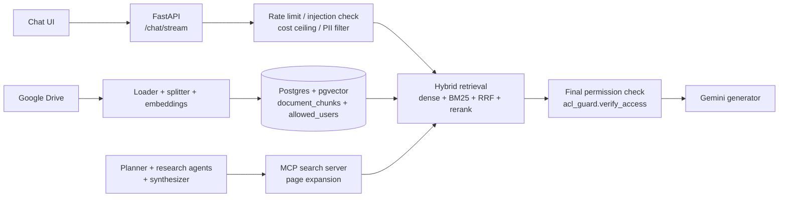

# Enterprise RAG Agent: Production RAG with Citations

A retrieval-augmented generation system over Google Drive documents, built in six stages: page-level citations, a streaming chat UI, an evaluation harness, cost routing, guardrails, and a permission-aware multi-agent research system using MCP.

Every claim about quality below comes from a measured run. Where the measurement is weak, the README says so.

## What it does

1. **RAG with page citations.** Documents are read from Google Drive (OAuth), split into ~500-character chunks, embedded, and stored in Postgres with pgvector. Answers cite `[file.pdf p.N]`.
2. **Streaming chat UI.** FastAPI + Server-Sent Events, plain HTML/CSS/JS (no build step). Model output is sanitized with DOMPurify before rendering.
3. **Evaluation harness.** RAGAS faithfulness plus retrieval-hit and citation checks on a 17-question golden set.
4. **Cost routing and logging.** Each request is classified into a model tier, checked against a rolling 24-hour spending ceiling, and logged.
5. **Guardrails.** Rate limits (per session and per IP), prompt-injection check, PII redaction, optional faithfulness guard, and a block log.
6. **Multi-agent research (MCP).** A planner splits a question into sub-questions, parallel research agents search through an MCP tool server, and a synthesizer writes the answer. Single-agent mode is also available.

## Architecture



**Retrieval.** Dense search (pgvector, permission filter in SQL) and BM25 (in memory) are fused with reciprocal rank fusion and reranked by a cross-encoder (`ms-marco-MiniLM-L-6-v2`). Every search ends with a permission check against the database (`verify_access`), so a stale in-memory index cannot leak a restricted chunk.

**Agents.** The agents talk to the documents only through an MCP tool, `search_documents`. The user identity is set by the application (`RAG_USER_ID`) and cannot be changed by the model. The MCP server drops chunks that contain injected instructions. Agent runs are guarded (injection check, cost ceiling, PII redaction) and traced.

## Evaluation

All numbers are from this repo's own eval tooling. Datasets are in `data/`.

### Stage 3: chat pipeline, 17-question golden set

Run `data/eval_runs/run_20261010_030259.json` (kept as `data/eval_baseline.json`). Answers by Gemini; faithfulness judged by Groq `gpt-oss-120b` (a different model family from the generator).

| Metric | Result |
|---|---|
| Pass | 16 / 17 (0.94) |
| Retrieval hit (right page retrieved) | 0.93 |
| Citation correct | 0.93 |
| Faithfulness (average) | 0.99 |

Caveats: only 14 of 17 rows had a faithfulness score, so 2 passes have no faithfulness check behind them. Earlier and later runs in the same period were disrupted by free-tier API errors, so only the best complete run is kept.

### Stage 6: single agent vs multi-agent, 6 multi-part questions

Dataset: `data/golden_multi.json` (questions with expected answers and expected pages). Agents run on Groq `gpt-oss-120b`. Besides faithfulness, I score **coverage**: a judge splits the expected answer into key facts and counts how many the answer states correctly.

| | Single, before | Single + page expansion | Multi, before | Multi + page expansion |
|---|---|---|---|---|
| Coverage | 0.65 | **0.92** | 0.66 | 0.83 |
| Wrong facts | 0 | 0 | 3 | 0 |
| Faithfulness | 0.88 | 0.90 | 0.61 | 0.84 |
| Pass | 0.67 | 0.83 | 0.17 | 0.50 |
| Tokens per question | 4,450 | 4,999 | 13,070 | 14,824 |

### What I learned

- **Faithfulness does not measure completeness.** An answer that says little but says it correctly scores high. Adding a coverage metric exposed answers that faithfulness had scored as fine.
- **Page-hit metrics overstated retrieval quality.** The expected page was usually retrieved, but the chunks holding the actual lists were not. The agent then answered "the documents do not include that" while the text sat on the page it had cited.
- **The cause was chunk granularity, not the model or the agent design.** With 500-character chunks, lists were split across chunks that ranked below the top 6. A free offline test (no model calls) measured how many distinctive words of the expected answers appeared in the retrieved text: top 6 chunks 0.70, top 15 chunks 0.81, top 6 plus the three best whole pages **0.91**, using fewer characters than top 15.
- **Fix: page expansion** in the MCP search server. After a search, the whole pages of the first 3 result pages are added (capped at 6,000 characters). Every added chunk passes the same permission check, and expansion is skipped if no permission checker is wired in. Single-agent coverage rose from 0.65 to 0.92 for about 12% more tokens.
- **Multi-agent was not better than single-agent here, and cost about 3x the tokens.** The coverage gap (0.83 vs 0.92) is within noise for six questions, so the safe claim is "not better, and more expensive" on this document, not "worse".
- **Weak spots of my own setup:** the first "expansion" run actually measured plain top 6, because environment variables did not reach the MCP subprocess. I caught it with a direct test and fixed it. Details of that kind are why the eval tooling records its own errors.

### Evaluation caveats

- Six questions and one document. One question moves an average by about 0.17.
- The stage-6 judge is Groq `gpt-oss-120b`, the same model family as the agents, so it is not independent. A Gemini cross-check was blocked by free-tier quota errors and is future work. Re-scoring the old single-agent baseline with the same judge gave 0.65, close to the 0.66 from the Gemini judge, which is reassuring but not proof.
- The old multi-agent faithfulness (0.61) was judged by Gemini; the other columns by Groq.
- The single-agent baseline changed slightly: it now fixes 6 chunks per search instead of letting the model choose up to 6.
- When re-judging two long multi-agent answers, the evidence passed to the judge was capped at 12,000 characters, which may have lowered their faithfulness scores.
- The Groq free tier (8,000 tokens per minute) caused agent failures when questions ran back to back; long pauses between questions fixed it.
- Page expansion is **not** used by the chat app yet (chat retrieves the top 5). On the 17 simple questions, plain top 10 matched expansion in the offline test, so expansion's clear win is on multi-part list questions.

## Security and permissions

- Each chunk has `allowed_users` (empty means public). Permissions are enforced three times: in the dense SQL query, in BM25 filtering, and in a final database check on every search.
- Page expansion re-checks every added chunk. Tests cover a blocked page, a missing checker, and per-user access (owner sees a restricted chunk, other users and anonymous do not).
- Guardrails: per-session and per-IP rate limits, prompt-injection check, PII redaction, optional faithfulness guard (`FAITHFULNESS_GUARD=1`), cost ceiling, and a block log in `data/logs/blocks.jsonl`.
- The chat UI escapes the user's text and sanitizes rendered markdown (DOMPurify). Secrets (`.env`, `credentials.json`, `token.json`) are git-ignored and were never committed.
- **Known limitation:** the chat API takes `user_id` from the request body, so there is no real sign-in. Permissions are enforced correctly *given* a user id, but the id is not authenticated. Do not expose this as-is to untrusted users.

## Setup

Tested on macOS with Python 3.10 in a fresh virtual environment (unit tests, imports and an embedding-model load; not a full chat or agent run on the fresh install).

```bash
git clone https://github.com/mukaram163/enterprise-rag-agent.git
cd enterprise-rag-agent
python3 -m venv venv && source venv/bin/activate
pip install -r requirements.txt        # numpy is pinned below 2 on purpose (torch compatibility)
cp .env.example .env                   # then fill in your keys
docker compose up -d                   # Postgres + pgvector
```

Google Drive access needs OAuth credentials (`credentials.json`) from your own Google Cloud project; the first run asks you to sign in and writes `token.json`. If it later reports `invalid_grant`, the token has expired: delete `token.json` and authorize again.

## Run

```bash
python3 -m uvicorn src.api.app:app --port 8000     # chat UI at http://localhost:8000

# agents
python3 -m src.agents.guarded "your question"      # guarded multi-agent run
python3 -m src.agents.guarded --user alice@example.com "your question"
python3 -m src.agents.trace 1                      # show the last agent run's trace

# page expansion is on by default in the MCP search server; turn it off with:
RAG_EXPAND_PAGES=0 python3 -m src.agents.guarded "your question"
```

Evaluation:

```bash
python3 -m src.evaluation.run_eval                                    # stage 3, 17 questions
python3 -m src.evaluation.run_agent_eval --system single --dataset data/golden_multi.json --judge groq --sleep 90
python3 -m src.evaluation.run_agent_eval --system multi  --dataset data/golden_multi.json --judge groq --sleep 120
python3 -m src.evaluation.score_answers --dataset data/golden_multi.json --judge groq
```

Agent evaluation needs `GROQ_API_KEY` (and `GEMINI_API_KEY` for the chat generator). Use long `--sleep` values on the Groq free tier.

Tests and proofs:

```bash
python3 -m pytest tests -q                          # unit tests
python3 scripts/acl_smoke_test.py                   # permission smoke test
python3 scripts/acl_stale_index_test.py             # stale-index permission test
python3 scripts/expand_pages_test.py                # expansion respects the checker
python3 scripts/acl_expansion_test.py               # per-user expansion test
python3 scripts/retrieval_strategies.py             # free retrieval experiment
```

## Repository layout
src/api/ FastAPI app, request schemas, citation parser
src/ui/ index.html, style.css, chat.js
src/ingestion/ Drive loading, splitting, embeddings, indexing, watcher
src/retrieval/ dense, sparse (BM25), hybrid RRF, reranker, permission guard
src/generation/ Gemini generator
src/agents/ planner, single agent, parallel agents, synthesizer, guardrails, trace
src/mcp_tools/ MCP search server (page expansion, injection filter)
src/evaluation/ eval runners, coverage scorer, red-team script
src/utils/ router, cost guard, rate limiter, injection/PII filters, logging
scripts/ permission tests and retrieval experiments
tests/ unit tests
data/ golden datasets and the stage-3 baseline

## Limitations and future work

- Authenticate the chat API (sign-in) instead of trusting `user_id` from the request body.
- Use page expansion in the chat path, with its own regression check on the 17-question set.
- Agent mode in the chat UI.
- Tune the multi-agent system one change at a time (sub-questions that carry the original question's context, a number-consistency check in the synthesizer, capped decomposition). Q1 of the multi-agent run once used 21 model calls.
- Re-score with an independent judge (Gemini cross-check) and a larger question set; run the 17-question set through the agents.
- Page-group scoring: some questions have several valid pages, and the "all pages" check can penalize a correct alternative.
- Drive sync needs a refreshed OAuth token (see Setup).
- Python 3.10 is past end of support; upgrade and re-run the tests.
- Component wiring still lives in `src/api/app.py` as module-level state that the agents and scripts read; moving it into its own module is a larger refactor.
